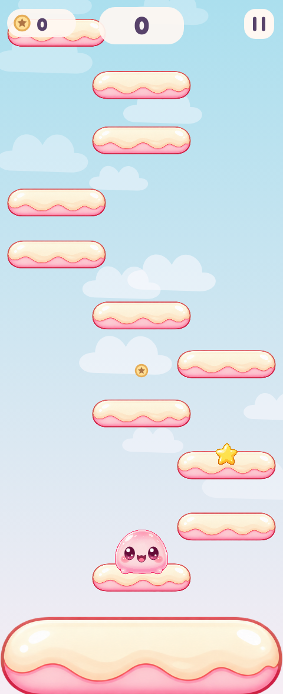
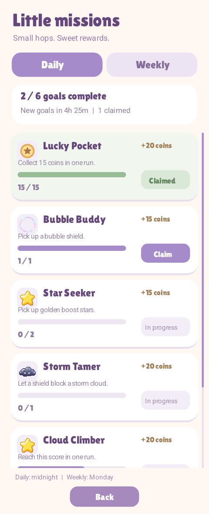

# Android Game Project

### A pastel platformer, shaped through iterative design and on-device playtesting.

An offline, portrait Android game about climbing an endless sequence of platforms. Players steer with phone tilt or touch, collect coins, avoid moving hazards, and unlock character styles and accessories.

**Status:** Playable development prototype · **Platform:** Android · **Source:** Private

This page is an anonymized portfolio overview. The product name, branding, source code, installation builds, and private development links are intentionally withheld.

## A look inside

<table>
  <tr>
    <td align="center"></td>
    <td align="center"></td>
  </tr>
  <tr>
    <td align="center"><strong>Vertical platforming</strong> Gentle opening platforms and touch or tilt steering.</td>
    <td align="center"><strong>Daily & weekly goals</strong> Progress tracking, collectible rewards and persistent claims.</td>
  </tr>
</table>

*Actual captures from development builds, selected to omit the title and logo. These are not mockups; layouts and balancing remain subject to change.*

## Implemented experience

- **A complete local play loop:** home, play, pause, results, retry, settings, customization and goals screens.
- **Two ways to steer:** accelerometer input with an upright neutral position, or holding either side of the touchscreen. A first-play guide introduces the controls; retries skip it.
- **Procedural traversal:** normal, horizontally moving, single-hit breakable and trampoline platforms. Opening platforms are wider, with a minimum width retained as difficulty increases.
- **Responsive character animation:** separately drawn eyes and mouth, gaze movement, blinking, landing squash and rebound.
- **Collectibles and obstacles:** coins, a temporary boost, a bubble shield and a moving storm hazard. Broken platforms fragment and fade; stalled runs can end automatically.
- **Local progression:** ten character variants, hats, face accessories and palette-based trails, with saved ownership and equipped items.
- **Rotating goals:** separate daily and weekly tabs, progress bars, claim states and capped rewards. Progress and purchases persist on the device.
- **Height-driven scenery:** a gradual sky-to-space transition rendered in code.

## Engineering approach

The game uses the native Android framework and a custom 2D renderer rather than a third-party game engine.

| Area | Technology and purpose |
| --- | --- |
| Language | Java, with Java 8 language compatibility; JDK 17 development toolchain |
| Rendering | Android `View` and `Canvas`, scheduled with `Choreographer` |
| Simulation | Fixed-step game model at 120 simulation updates per second; this is not a promised display frame rate |
| Controls | Android accelerometer and touchscreen events |
| Audio | Android `SoundPool` for event-based effects |
| Persistence | `SharedPreferences` for local progress; bundled JSON for the customization catalog |
| Goals | Java date/time APIs for daily and weekly periods |
| Visuals | PNG assets, code-drawn scenery and effects, an OFL-licensed display font and system text |
| Builds | Android SDK tools and PowerShell build scripts; Android Gradle configuration is also included |
| Verification | Java model tests, Android instrumentation, Android 15 emulator checks and ADB development installs |

The current configuration targets Android API 35 with a minimum of API 26. The verified build path uses the SDK packaging, Java compilation, DEX conversion, alignment and signing tools through local scripts.

**No backend is required.** The prototype has no account system, remote database, application server, cloud saves or multiplayer. Its progression and calendar-based goals operate locally.

## My role in AI-assisted development

I lead the project’s creative direction, feature decisions and acceptance criteria. I define the visual style, select and refine artwork and sound candidates, playtest Android builds, identify usability and gameplay problems, and guide revisions to controls, difficulty, rewards and customization.

AI coding assistance has produced substantial parts of the implementation, tests, build tooling and technical investigation under my direction. AI tools have also helped generate and edit visual assets. I review the results through iterative feedback and hands-on playtesting; this is not presented as an entirely hand-coded or entirely hand-drawn project.

Examples of my decisions include reducing overly generous rewards, improving hazard spacing, introducing wider beginner platforms, keeping a practical minimum platform width, and limiting the controls guide to the first play of an app session.

## Current development status

| State | Scope |
| --- | --- |
| **Implemented** | Playable offline loop, customization, animated character faces, platform mechanics, local saves, daily/weekly goals and gradual scenery changes |
| **Verified during development** | Signed builds, Android emulator runtime checks, model and goals tests, and development builds installed on a physical Android phone |
| **Still being refined** | Difficulty balance, platform spacing, animation feel and broader device testing |
| **Discussed / planned** | Longer platforms that preserve their thickness and rounded ends; selected replacement sound effects still need integration |
| **Before any release** | Complete remaining temporary asset/audio replacement and provenance review, then repeat release-focused device testing |

Verification has included seeded traversal simulations, platform collision cases, goal reset and repeat-claim behavior, UI interaction and save persistence. Test coverage varies by build; this is not a claim that every feature has passed on every device. There is no public production release or CI/CD pipeline to report.

## Next steps

1. Introduce wider platform variants without stretching their height or distorting key details.
2. Integrate the selected sound replacements and tune repeated effects during play.
3. Continue real-device testing and progression balancing.
4. Finish asset provenance and release-readiness checks.

---

**Portfolio showcase only.** Source code and development builds are not distributed here. Screenshots document work in progress and do not imply a finished commercial release.
